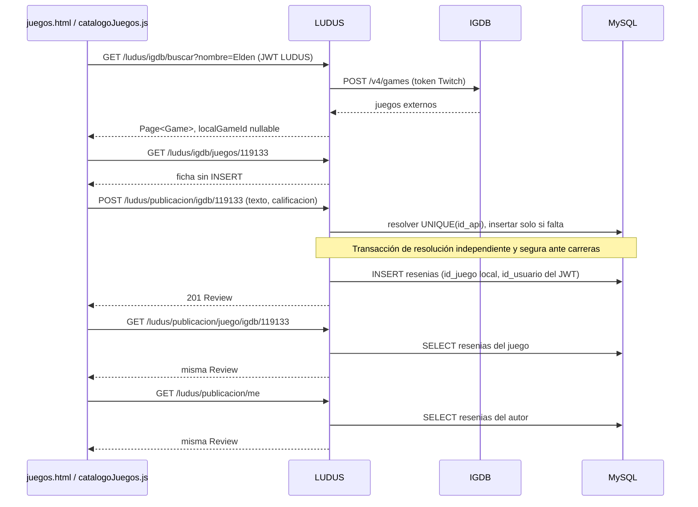

# Guía para conectar el frontend existente (sin cambios aplicados aún)

Se inspeccionaron en lectura `../Proyecto-integrador/juegos.html`, `JS/api.js`,
`JS/catalogoJuegos.js`, `perfil.html`, `JS/perfilUsuario.js` y `JS/resenias.js`.
No se modificó ninguno de esos archivos. Mantener sus clases Bootstrap, CSS y estructura visual.
El backend está implementado; **el frontend todavía no está integrado**.

## 1. Preparación

Aplicar la migración manual de backend en una base de pruebas antes de habilitar escritura:
ver [estado y operación](IGDB_BACKEND_ESTADO.md).
Servidor local `http://localhost:8080`; frontend desde `http://localhost:5502` o
`http://127.0.0.1:5502`, únicos orígenes CORS actuales.

`consumeApi(endpoint, {method='GET',body,auth=true})` ya adjunta JWT LUDUS,
hace JSON.stringify(body), interpreta JSON y limpia sesión ante 401.
**Pasarle un objeto JS en body, nunca JSON.stringify(objeto)**.
No cambiar auth a false para catálogo: todos sus endpoints requieren sesión.
Mantener getAuthToken/getCurrentUser/requireAuth como ayudas de UI; el backend decide el autor.
No enviar correos, idUsuario, fechas ni Client Secret/Twitch token.
Los errores son Error(message); consumeApi actual no conserva status/Retry-After.

## 2. Sustituir loadGames y el filtrado local de catalogoJuegos.js

Estado actual comprobado:

- loadGames() llama GET /ludus/juego/, exige array y mapea id_juego a string.
- renderCatalog() filtra en memoria por nombre/categoría/plataforma.
- searchInput (#game-search) tiene listener input -> renderCatalog.
- initializeCatalog() carga toda la lista y busca games.find para el parámetro ?id.
- renderDetail(), readReviews(), getReviews(), saveReviews() y makeId() usan
  ludus_catalogo_resenias en localStorage. El submit guarda userEmail/userName y UUID local.

Sustituir la carga global por un estado paginado. Cuando hay texto usar
GET /ludus/igdb/buscar?nombre=...; cuando no, GET /ludus/igdb/juegos.
La búsqueda por texto solo admite relevancia; explorar admite rating/lanzamiento/nombre.
**No filtrar otra vez únicamente la página recibida**: eso ocultaría resultados válidos
de páginas siguientes y daría la impresión de un filtro global inexistente.

Adaptador temporal para conservar renderizado y CSS:

```js
function toCatalogGame(dto) {
  return {
    id: String(dto.igdbId), // solo identificador visual; ya NO significa PK local
    igdbId: dto.igdbId,
    localGameId: dto.localGameId,
    name: dto.nombre,
    category: dto.generos.map(x => x.nombre).join(", "),
    platform: dto.plataformas.map(x => x.nombre).join(", "),
    description: dto.descripcion || "",
    imageUrl: dto.portadaUrl,
    socialAverage: dto.ratingLudus.promedio,
    reviewCount: dto.ratingLudus.cantidad
  };
}
```

| Campo usado hoy en loadGames | Nuevo DTO |
|---|---|
| id_juego | localGameId nullable; no usar como identificador de resultados externos |
| identificador externo ausente en UI | igdbId |
| nombre_juego | nombre |
| categoria | generos: [{id,nombre}] |
| plataforma | plataformas: [{id,nombre}] |
| descripcion | descripcion nullable |
| imagen_url | portadaUrl nullable |
| promedio calculado desde localStorage | ratingLudus.promedio y ratingLudus.cantidad |

Ejemplo de carga usando **consumeApi existente**, sin modificar su firma:

```js
let catalogRequest = 0;
async function loadCatalogPage({ text = "", genreId, platformId, page = 0, size = 10, sort = "rating" } = {}) {
  const generation = ++catalogRequest;
  const query = new URLSearchParams({ page: String(page), size: String(size) });
  if (genreId) query.set("genreId", String(genreId));
  if (platformId) query.set("platformId", String(platformId));
  const searching = text.trim().length > 0;
  query.set("sort", searching ? "relevancia" : sort);
  if (searching) query.set("nombre", text.trim());
  const path = searching ? "/ludus/igdb/buscar" : "/ludus/igdb/juegos";
  // Aquí mostrar loading y desactivar botón de siguiente/publicar según corresponda.
  try {
    const result = await consumeApi(path + "?" + query.toString(), { auth: true });
    if (generation !== catalogRequest) return null; // ignora respuestas obsoletas
    return { games: result.items.map(toCatalogGame), page: result.page, hasNext: result.hasNext };
  } catch (error) {
    if (generation !== catalogRequest) return null;
    throw error; // el llamador muestra error sin borrar una página válida previa
  }
}
let searchTimer;
searchInput.addEventListener("input", () => {
  clearTimeout(searchTimer);
  ++catalogRequest; // invalida respuestas previas inmediatamente
  searchTimer = setTimeout(() => {
    // Llamar loadCatalogPage({text: searchInput.value, genreId, platformId, page:0})
    // y actualizar renderCatalog con los resultados, manejando catch/loading.
  }, 350);
});
```

Reemplazar el listener viejo; no dejar ambos activos.
Cambiar filtro/texto/sort reinicia page=0. Siguiente o “cargar más” se ofrece solo con hasNext.
Incrementar page únicamente tras éxito; al añadir páginas deduplicar por igdbId.
No hay total global: countElement puede indicar “N juegos cargados”, no “N resultados totales”.
Si una consulta falla, conservar filtros/texto y ofrecer reintento explícito.

**Cancelación**: api.js actual no admite signal y lo ignoraría.
El ejemplo usa una generación para descartar resultados obsoletos, pero la solicitud sigue en red.
Si posteriormente se decide abortar de verdad, ampliar consumeApi a recibir signal y pasarlo a fetch;
entonces usar AbortController y tratar AbortError como cancelación. Esa ampliación está pendiente,
no está implementada en este repositorio. No asumir que pasar signal hoy cancela nada.

## 3. Selects de género y plataforma

La página actual solo tiene #game-search; los selects son una futura adición al mismo layout.
Cargar /ludus/igdb/generos y /ludus/igdb/plataformas con page/size, hasta hasNext=false;
conservar las opciones en memoria por sesión. No disparar decenas de páginas simultáneas.
Lookup: {id,nombre}; option.value=String(id), texto con textContent.
Enviar un genreId y un platformId como números positivos; se combinan con AND.
Un select vacío omite el parámetro, no envía 0, "null" ni etiquetas.
Texto + ambos filtros funciona. Un sort distinto de relevancia en búsqueda produce 400;
desactivar el selector de orden o cambiarlo automáticamente durante búsqueda.
La cuota puede dar 503; no hacer polling ni reintentos paralelos. Reintentar con pausa acotada.

## 4. URLs de ficha: distinguir externo de local

Nuevas tarjetas deben enlazar a `juegos.html?igdbId=119133`.
En renderCatalog cambiar únicamente el destino del enlace, preservando clases y portada.
initializeCatalog() debe resolver la URL **antes de cargar el catálogo**:

1. Si hay igdbId: GET /ludus/igdb/juegos/{igdbId}, aunque localGameId sea null.
2. Si hay id legado: GET /ludus/juego/{id}; su id_api es el IGDB ID, salvo datos ficticios históricos.
   Mostrar el dato local para no romper enlaces; intentar enriquecer con detalle externo solo cuando sea válido.
   Si IGDB devuelve 404 para el juego de prueba, mostrar estado local y no convertir ese ID ficticio
   en otro juego automáticamente. No borrar ese juego ni sus reseñas.
3. Sin parámetros: mostrar la primera página del catálogo.

Eliminar la dependencia de games.find() y de findAll() para abrir detalle.
No cambiar retroactivamente el significado de ?id=4; ese id sigue siendo local.
Validar enteros positivos antes de armar la URL. encodeURIComponent/URLSearchParams para toda entrada.
renderDetail() debe recibir también igdbId y localGameId por separado, no inferir uno del otro.

Descripción nula -> texto opcional; portada nula -> placeholder existente createCover.
Conservar safeImageUrl/addText, usar textContent para nombre, descripción, reseña y autor.
No insertar strings del proveedor o usuario con innerHTML.
HTTPS para imágenes; portada t_cover_big sirve también para cards, screenshots t_screenshot_big.
Fecha externa en segundos UTC; no confundirla con fechaPublicacion de reseñas.

## 5. Ficha + reseñas MySQL

Reemplazar getReviews().filter(gameId) en renderDetail por consulta asíncrona:
GET /ludus/publicacion/juego/igdb/{igdbId}?page=0&size=20.
Devuelve reseñas de TODOS los autores autenticados visibles, aunque el visitante sea otro usuario.
Sin fila local/reseñas devuelve items=[], sin registrar el juego.
El detalle externo ya incluye ratingLudus; para refrescar sin repetir IGDB usar
GET /ludus/publicacion/juego/igdb/{igdbId}/rating.
No calcular media/cantidad con una página ni mezclar ratingIgdb (0..100) con LUDUS (1..5).

Ejemplo completo de acciones usando consumeApi:

```js
const game = await consumeApi("/ludus/igdb/juegos/119133", { auth: true });
const reviews = await consumeApi("/ludus/publicacion/juego/igdb/119133?page=0&size=20");

async function publishReview(igdbId, texto, calificacion) {
  const created = await consumeApi("/ludus/publicacion/igdb/" + encodeURIComponent(igdbId), {
    method: "POST", auth: true, body: { texto, calificacion: Number(calificacion) }
  });
  // created.juego.localGameId es la FK local REAL; created.autor es quien firmó el JWT.
  return created;
}
async function editReview(idResenia, texto, calificacion) {
  return consumeApi("/ludus/publicacion/" + encodeURIComponent(idResenia), {
    method: "PUT", auth: true, body: { texto, calificacion: Number(calificacion) }
  });
}
async function deleteReview(idResenia) {
  await consumeApi("/ludus/publicacion/" + encodeURIComponent(idResenia), { method: "DELETE", auth: true });
  // 204 => consumeApi devuelve null; no intentar leer JSON adicional.
}
async function refreshGameReviews(igdbId, page = 0) {
  const path = "/ludus/publicacion/juego/igdb/" + encodeURIComponent(igdbId);
  const [list, rating] = await Promise.all([
    consumeApi(path + "?page=" + page + "&size=20"),
    consumeApi(path + "/rating")
  ]);
  return { list, rating };
}
```

El submit hoy síncrono de renderDetail debe ser async, await publishReview y catch explícito.
Desactivar submit hasta finalizar; no mostrar éxito antes de 201; no guardar una copia automática
en localStorage como si fuera la fuente de verdad. Cada usuario tiene como máximo una reseña por juego:
ambas rutas POST devuelven 409 si ya existe, incluso con doble clic o peticiones concurrentes.
Consultar /ludus/perfil/me para identificar al usuario y buscar su autor.idUsuario entre las reseñas
del juego (recorriendo páginas si hace falta), o consultar /ludus/publicacion/me paginado y filtrar
por juego.igdbId. Si ya existe, ofrecer editar/eliminar por idResenia en vez de “Publicar”.
La comprobación visual no reemplaza al backend: ante 409, recargar esos datos y ofrecer edición,
sin sobrescribir ni borrar automáticamente. Tras DELETE propio se puede volver a publicar.
Ante error de red incierto, consultar antes de repetir; el POST no es un upsert.
consumeApi actual solo expone message: para distinguir HTTP 409 de forma robusta será necesario
conservar response.status en el Error en una futura modificación de api.js; no se modificó aquí.

Para la ruta mínima compatible de dos pasos:

```js
const local = await consumeApi("/ludus/igdb/juegos/119133/resolver", {method:"POST",auth:true});
const review = await consumeApi("/ludus/publicacion/", {
  method:"POST", auth:true,
  body:{juego:{id_juego:local.id_juego},texto_resenia:"Excelente",calificacion:5}
});
```

La ruta de un paso /publicacion/igdb/{igdbId} evita manejar esa resolución en la UI.
Los dos flujos usan resenias.id_juego -> juegos.id_juego y el usuario del JWT.



## 6. Perfil propio y ajeno (archivos reales)

perfil.html importa JS/perfilUsuario.js y JS/resenias.js.
perfilUsuario.js usa loadProfile(), saveProfile(), showProfile(), loadReviewStatistics()
y updateStatistics(); actualmente lee perfil-usuario y resenias-videojuegos en localStorage.
resenias.js usa loadReviews(), saveReviews(), renderReviews(), createReviewCard() y editingIndex.
Su saveReviews() contiene un intento hacia **/ludus/resenia/** (ruta inexistente),
pasa body:JSON.stringify(...) y no espera await: **reemplazar ese bloque**, no replicarlo.

Flujos definitivos:

```js
const myProfile = await consumeApi("/ludus/perfil/me");
const myReviews = await consumeApi("/ludus/publicacion/me?page=0&size=20");
const otherId = 2; // parámetro idUsuario validado de perfil.html
const otherProfile = await consumeApi("/ludus/perfil/" + otherId);
const otherReviews = await consumeApi("/ludus/publicacion/usuario/" + otherId + "?page=0&size=20");
const changedProfile = await consumeApi("/ludus/perfil/me", {
  method:"PUT", auth:true, body:{nombre:"Ana",sobreMi:"Juego RPG"}
});
```

Sustituir loadProfile por GET perfil/me o perfil/{idUsuario}; showProfile conserva DOM y CSS:
#perfil-alias / #nombre-usuario <- nombre; #perfil-descripcion <- sobreMi.
Actualizar saveProfile para persistir nombre/sobreMi con PUT propio.
Avatares, portadas, recortes, icono y colores son personalización local actual:
no enviarlos al backend ni afirmar que se sincronizan; mantenerlos separados hasta un trabajo de uploads.

Reemplazar loadReviewStatistics y updateStatistics para usar los agregados del perfil:
#perfil-total-likes <- totalLikes (recibidos); #perfil-promedio-calificacion <- promedioCalificacion
(o “—” si null); #perfil-juegos-resenados <- juegosResenados.
cantidadResenias también está disponible. No calcular totales con los 20 elementos visibles.

Sustituir loadReviews por página de /publicacion/me o /publicacion/usuario/{id}.
Adaptar createReviewCard con Review:
idResenia -> identificador estable de edición; texto -> reviewText; calificacion -> rating;
juego.nombre -> nombre del juego; juego.portadaUrl -> imagen;
fechaPublicacion -> fecha mostrada; autor.nombre -> autor.
Eliminar edición por posición editingIndex como identidad persistente; usar idResenia.
El título del formulario no basta para publicar: añadir selección de resultado IGDB, conservar igdbId
y llamar el mismo publishReview() que la ficha, sin buscar por nombres al guardar.

Mostrar editar/borrar solo si review.autor.idUsuario === myProfile.idUsuario.
Eso es UX: el backend siempre devuelve 403 si se intenta modificar una reseña ajena.
Tras crear/editar/borrar, recargar reseñas, perfil/contadores y rating del juego.
Ambas páginas consultan MySQL; no enviar eventos con copias completas de reseñas como fuente alternativa.
Si se conservan eventos de UI, que invaliden/recarguen datos desde API.

## 7. Migración voluntaria de localStorage (NO ejecutada)

Claves inspeccionadas: ludus_catalogo_resenias (catálogo), resenias-videojuegos (perfil/reseñas),
perfil-usuario (personalización). Pueden contener formatos e identidades diferentes.
No borrarlas, sobrescribirlas ni importarlas automáticamente al iniciar sesión.

Orden propuesto con consentimiento explícito:

1. Ofrecer exportación JSON de respaldo del navegador; mostrar una vista previa.
2. Usuario autenticado selecciona sus borradores y confirma autoría; userEmail del JSON
   solo ayuda a presentar, nunca autoriza ni suplanta identidad.
3. Resolver cada juego por IGDB con selección humana: un gameId viejo local o nombre libre
   no demuestra correspondencia con un igdbId. No convertir IDs ficticios automáticamente.
4. Importar cada borrador elegido mediante POST /publicacion/igdb/{igdbId}, texto/calificación
   válidos, como el usuario del JWT actual. El backend asignará fecha actual e id nuevos;
   no importa fechas históricas ni otros autores.
5. Guardar un registro local de idResenia recibido por borrador importado para evitar repetirlo;
   comparar con lista del servidor si el POST tuvo resultado incierto. Si ya hay una reseña propia
   del juego, el POST devuelve 409: conservar el borrador y ofrecer edición consentida de la reseña
   existente. Varios borradores del mismo juego no pueden importarse como reseñas independientes.
6. Conservar originales hasta verificación y consentimiento posterior para archivarlos.
   No duplicar importación entre las dos claves. No implementar limpieza global.

Esta migración requiere trabajo frontend posterior y consentimiento; no hay endpoint de importación masiva.
No se asegura que existan reseñas del navegador en MySQL hasta ejecutar el POST y verificar sus GET.

## 8. Estados y checklist de aceptación manual

Estados: loading (sin texto “vacío” prematuro), empty (items=[] sin error), error con reintento,
y contenido. Tras 401 consumeApi limpia sesión: mostrar login/redirección;
403 mostrar permiso denegado; 404 ficha/perfil inexistente; 503 esperar y reintentar;
502/504 indicar servicio externo temporalmente no disponible sin vaciar reseñas locales cargadas.
No repetir automáticamente POST, PUT o DELETE por fallos de proveedor.
Para interpretar códigos de forma fina, ampliar posteriormente consumeApi para conservar status;
su versión actual solo da message. No depender de analizar texto libre como protocolo.

Orden recomendado:

1. Configurar backend/DB y probar login + endpoints con Postman.
2. Cargar página de catálogo tipada; conservar cards/CSS.
3. Agregar filtros, debounce y paginación; verificar búsqueda real y errores.
4. Cambiar enlaces a ?igdbId y detalle directo; probar enlaces ?id heredados.
5. Conectar lecturas de reseñas y rating.
6. Activar POST/PUT/DELETE propios con selección IGDB y bloqueo de doble clic.
7. Integrar perfil/me y perfiles ajenos con DTO/estadísticas.
8. Solo después, ofrecer importación localStorage voluntaria y respaldada.

Checklist:

- [ ] Sin sesión no se abre API protegida; sesión válida permite catálogo y CORS.
- [ ] Texto Unicode/comillas funciona; texto+género+plataforma filtra en servidor.
- [ ] Cambiar rápido el texto no renderiza respuestas antiguas.
- [ ] hasNext controla paginación; no se inventa total global.
- [ ] Ficha abre por igdbId aunque localGameId sea null y sin cargar todo el catálogo.
- [ ] Navegar/buscar/detallar no crea juegos.
- [ ] Portada/descripcion nulas y listas vacías no rompen UI ni permiten XSS.
- [ ] Primer POST crea la reseña; repetir por ruta externa/local devuelve 409 y conserva la original.
- [ ] Dos usuarios pueden reseñar el mismo juego; uno no puede mantener dos reseñas de ese juego.
- [ ] Editar/eliminar propios funciona; tras borrar se permite publicar otra vez.
- [ ] Esa idResenia aparece en ficha para usuarios A/B y en perfil de su autor.
- [ ] Editar/borrar propios actualiza ficha, perfil y medias; ajenos devuelven 403.
- [ ] No se envía idUsuario ni userEmail como identidad y no se imprimen tokens.
- [ ] No se usa /ludus/resenia/ ni body doblemente serializado.
- [ ] localStorage conserva originales hasta consentimiento.
- [ ] HTML, JS y CSS se cambian y prueban solo en el siguiente trabajo autorizado.
